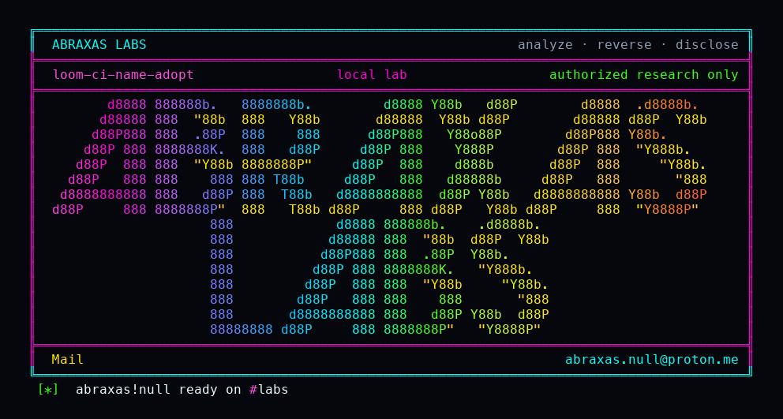

<p align="center">
  
</p>

# loom-ci-name-adopt

An agent administrator in one group can name a harness so the code-interpreter name Loom derives is the name another group already has. The new row stores that existing interpreter id. A later delete of the administrator's own agent, with cloud cleanup on, deletes that interpreter.

They still cannot open the other group's agent. The lab did not run code as the other group's role. AWS was stubbed. What was recorded is the id being stored, a different name not taking that id, and cleanup deleting the stored id.

**Class:** Account-wide name collision on a cloud resource, adopt on create and delete on cleanup
**Reach:** Remote. In-group `agent:write` (`g-admins-demo`). They supply an execution role and a code-interpreter role that already belong to their own group.

**[Loom](https://github.com/awslabs/loom)** [v1.10.3](https://github.com/awslabs/loom/releases/tag/v1.10.3) `cc10ab0`. This container ran on that tag. I did not run this oracle on v1.9.0.

| | |
|---|---|
| ID | no CVE yet |
| Class | **Harness code-interpreter name is not tied to the agent or the group** |
| Reach | **Remote**, `agent:write` in the caller's own group |
| CWE | [CWE-863](https://cwe.mitre.org/data/definitions/863.html) |
| CVSS | **High: 7.6** `CVSS:3.1/AV:N/AC:L/PR:H/UI:N/S:C/C:N/I:L/A:H` |
| Product | [awslabs/loom](https://github.com/awslabs/loom) |
| Affected | **v1.10.3** `cc10ab08573087fa12154f7c8181ffcd985fea88` |
| Auth | `g-admins-demo`. GET of the payments agent stayed 403. |
| License | [GNU Affero GPL v3.0](LICENSE) |
| Lab | loopback Docker, AWS clients stubbed, stack removed after the run |

Confidentiality is unscored because the other group's agent row was not readable. Availability is the interpreter delete.

## What an attacker can do

| Privilege | Method / sink | Impact | Lab-proven or inferred |
|---|---|---|---|
| Be refused the other group's agent | `GET /api/agents/{billing}` | Closed | Lab-proven 403. Body did not contain the interpreter id. |
| Store the existing interpreter id on a new harness | `POST /api/agents` name `billing_code_interpreter`, code interpreter enabled, own roles | Integrity. Both names strip to `loom_ci_billing`. | Lab-proven. Id `ci-billing-existing` stored, deployment READY, runtime id set. |
| Create a distinct interpreter for a different base name | `POST` name `payroll` | Negative control | Lab-proven. Stored `ci-created-1`, created name `loom_ci_payroll`. |
| Delete the adopted interpreter | `DELETE /api/agents/{own}?cleanup_aws=true` once `runtime_id` is set | Availability | Lab-proven. `deleted-ids=ci-billing-existing` |
| Run as the other group's interpreter role | n/a | Not claimed | Not labbed. The stub recorded ids. |
| Assign `loom:group=payments` or bind that group's role | create/delete guards | Closed | Demo can only create and delete in `demo`. |

**Stays closed**

| Axis | Method / sink | Why it is closed |
|---|---|---|
| Recon | GET or list of the payments agent as demo | 403 |
| Integrity | A harness whose stripped name differs | Does not reuse the billing id |
| Availability | DELETE without `cleanup_aws`, or with an empty runtime id | Cleanup returns before the interpreter delete |
| Integrity | Managed config keys and foreign IAM roles | Separate checks. This bug does not reopen them. |

`list_code_interpreters` is not paginated. A large account can miss the summary, and then this adopt does not see the target.

One footgun in the deploy function, not the bug: `memory_records` is only assigned when `memory_ids` is sent, and a later branch reads it when a code-interpreter role is set. The lab sends `memory_ids: [0]` so that name exists. An unknown id yields an empty list.

## How I found it

Harness names have to be unique as strings. The interpreter name is `loom_ci_` plus the harness name with a trailing `code_interpreter` stripped, then cut at 48 characters. `billing` and `billing_code_interpreter` are different rows and the same interpreter name. The create path lists interpreters in the account and, on a name match, saves that id on the new agent. There is no group compare.

I ran this on v1.10.3 `cc10ab0`. The stub listed `loom_ci_billing` as `ci-billing-existing`, recorded creates, and recorded deletes. The product source in the container was not patched.

## Lab

```bash
python3 loom-ci-name-adopt-Abraxas-Labs.py
```

```text
SUCCESS LOOM-1103-CI-ADOPT adopted=ci-billing-existing payroll-distinct=yes cleanup-deleted=yes LOOM-1103-CI-ADOPT-WITNESS
```

`run.sh` checks out v1.10.3, checks `cc10ab0`, and tears the stack down.

## The fix

Put the agent id, or the `loom:group`, in the interpreter name, and refuse to store an id whose name was not created for this row. On cleanup, delete only an interpreter this agent created. Page the list.

## References

- [awslabs/loom v1.10.3](https://github.com/awslabs/loom/releases/tag/v1.10.3) `cc10ab08573087fa12154f7c8181ffcd985fea88`
- [`agents.py` `_deploy_harness_background`](https://github.com/awslabs/loom/blob/cc10ab08573087fa12154f7c8181ffcd985fea88/backend/app/routers/agents.py#L2690)
- [name derivation](https://github.com/awslabs/loom/blob/cc10ab08573087fa12154f7c8181ffcd985fea88/backend/app/routers/agents.py#L2849)
- [CWE-863](https://cwe.mitre.org/data/definitions/863.html)
- [CVSS 3.1 calculator](https://www.first.org/cvss/calculator/3.1#CVSS:3.1/AV:N/AC:L/PR:H/UI:N/S:C/C:N/I:L/A:H)


## License

GNU Affero GPL v3.0. See [LICENSE](LICENSE). Loopback lab only. No warranty.

Abraxas Labs
abraxas.null@proton.me
